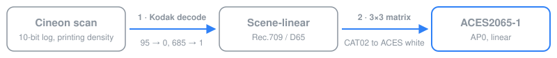
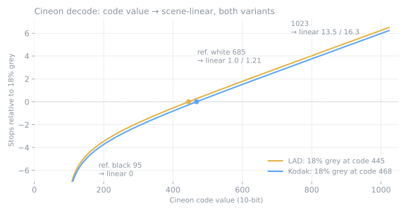

# cineon-aces-idt

[](https://github.com/maxlainz/cineon-aces-idt/actions/workflows/ci.yml)
[](https://github.com/maxlainz/cineon-aces-idt/releases/latest)
[](LICENSE)

An **ACES Input Transform for Cineon film scans** (Kodak convention) to **ACES2065-1**, in two variants and two formats:

| Variant | 18% grey | DCTL (DaVinci Resolve) | CLF (OpenColorIO 2.x, Nuke, Flame) |
|---|---|---|---|
| **LAD** (recommended) | code 445 | [`IDT_Cineon_LAD.dctl`](transforms/IDT/IDT_Cineon_LAD.dctl) | [`Cineon_LAD_to_ACES2065-1.clf`](transforms/Cineon_LAD_to_ACES2065-1.clf) |
| **Kodak** | code 468 | [`IDT_Cineon_Kodak.dctl`](transforms/IDT/IDT_Cineon_Kodak.dctl) | [`Cineon_to_ACES2065-1.clf`](transforms/Cineon_to_ACES2065-1.clf) |

Both share the same curve and matrix and differ only in exposure (0.27 stops). **LAD** puts an 18% grey card at code 445, Kodak's Laboratory Aim Density, which is how most labs align a Cineon scan. **Kodak** is the classic "685 = 1.0" convention used by compositing packages, which lands grey at 468. If you don't know how your scan was aligned, use LAD. The DCTL is an ACES DCTL, so Resolve lists it as one more Input Transform; the CLF is the Academy's Common LUT Format, readable by any OpenColorIO 2.x tool.

**[Download the latest release](https://github.com/maxlainz/cineon-aces-idt/releases/latest)**

## Why

ACES ships no Input Transform for Cineon scans. The closest one, ADX10, assumes scans calibrated to the Academy's printing density (APD) and inverts the negative with its own curves, so it doesn't match most "Cineon" scans that come out of a lab. This transform does the conventional Kodak decode instead, and lands it in ACES2065-1 the way any camera IDT would.

## What it does





**1. Cineon decode** (Kodak convention: reference black 95, reference white 685, 0.002 density per code value, negative gamma 0.6):

```
lin = (10^((1023·v − 685)·0.002/0.6) − k) / (1 − k),   k = 10^((95 − 685)·0.002/0.6)
```

Code 95 maps to 0, code 685 to 1.0, 18% grey sits at about code 468, and code 1023 reaches linear 13.5 (about 6 stops above grey). That is the **Kodak** variant. The **LAD** variant multiplies the result by a gain of 1.2056 so that code 445 gives exactly 0.18 (and 685 gives 1.21). In the CLF each variant is a single `Log` op in `logToLin` style, with `logSideSlope = 0.6/(0.002·1023)`, `logSideOffset = 685/1023`, `linSideOffset = k` and `linSideSlope = (1 − k)/gain`.

**2. Rec.709/D65 → AP0 matrix**, with **CAT02** chromatic adaptation to the ACES white point:

```
0.4395756842 0.3839125893 0.1765117265
0.0896003829 0.8147141542 0.0956854629
0.0174154827 0.1087343522 0.8738501650
```

## Colorimetry

A Cineon scan is printing density: it records how the negative would expose print stock, not colorimetry. It has no defined primaries or white point, so any route into ACES has to assume them. These are the assumptions, and the reasoning behind each one:

| | Assumed / used | Value (CIE xy) |
|---|---|---|
| Source primaries | Rec.709 / sRGB | R 0.640, 0.330 · G 0.300, 0.600 · B 0.150, 0.060 |
| Source white | D65 | 0.3127, 0.3290 |
| Destination primaries | ACES AP0 | R 0.7347, 0.2653 · G 0.0000, 1.0000 · B 0.0001, −0.0770 |
| Destination white | ACES white (≈ D60) | 0.32168, 0.33767 |
| Chromatic adaptation | CAT02, von Kries scaling in CAT02 cone space | |

- **Rec.709 primaries.** This is the conventional assumption for Cineon material: Nuke's `Cineon` colorspace, the classic VFX OpenColorIO configs and the traditional DI pipeline all treat linearised Cineon as Rec.709, so print-emulation LUTs and graders' expectations were built on it. It is a convention, not a measurement: the negative records colours more saturated than Rec.709, and this matrix keeps them inside it. Any other guess (P3, AP1, a "film gamut") would be just as arbitrary and less compatible. The route to measured colour is a per-stock matrix: shoot a colour chart on the stock, scan it like the footage, and fit a 3×3 against the chart's known ACES values. That would slot into the generator as one more variant.
- **D65 white, adapted to the ACES white.** Equal R = G = B in the decoded scan is treated as D65 and mapped to the ACES white, so neutrals in the scan stay neutral in ACES (R = G = B in AP0; checked by the tests). Without adaptation, a neutral would come out at R:G:B ≈ 1.00 : 1.01 : 1.08 in AP0, i.e. bluish.
- **CAT02.** Bradford, which the ACES OCIO configs use for their Rec.709 utility spaces, gives a matrix that differs by at most 0.003 per coefficient. Neutrals are identical with either; only saturated colours shift, by far less than the uncertainty of the Rec.709 assumption itself.
- **AP0 output.** An Input Transform must deliver ACES2065-1. Resolve and OCIO then convert to ACEScct/ACEScg for grading or comp.
- **No gamut mapping** is applied. Everything stays inside AP0, since Rec.709 is well inside it.

The matrix is computed in [`tools/cineon_idt.py`](tools/cineon_idt.py) from the xy values above: RGB→XYZ for Rec.709/D65, CAT02 from D65 to the ACES white, then XYZ→RGB for AP0.

## The two files

### DCTL: `IDT_Cineon_Kodak.dctl`

A DCTL is DaVinci Resolve's GPU shader format for color transforms. This one is a non-parametric **ACES DCTL** (`DEFINE_ACES_PARAM(IS_PARAMETRIC_ACES_TRANSFORM: 0)`): Resolve treats it as an ACES Input Transform and lists it next to the built-in ones, instead of as a LUT you apply on a node.

**Install**

1. Copy the `.dctl` you want (`IDT_Cineon_LAD.dctl`, `IDT_Cineon_Kodak.dctl`, or both) into Resolve's `ACES Transforms/IDT` folder:
   - macOS: `/Users/<your-user>/Library/Application Support/Blackmagic Design/DaVinci Resolve/ACES Transforms/IDT/` (the `Library` folder inside your user's home folder, hidden by default: in Finder use Go → Go to Folder… (Cmd+Shift+G) and paste `~/Library`, or press Cmd+Shift+. to show hidden files)
   - Windows: `%AppData%\Blackmagic Design\DaVinci Resolve\Support\ACES Transforms\IDT\`

   The `ACES Transforms` and `IDT` folders don't always exist on a fresh install. If they're missing, create them yourself with exactly those names.
2. Restart Resolve. It only scans that folder at startup.

**Use**

1. Project Settings → Color Management → set Color science to **ACEScct**. Not ACEScc: it cannot represent negative values, so everything below code 95 would be flattened to one value.
2. Pick **IDT_Cineon_LAD** (or **IDT_Cineon_Kodak**) as the ACES Input Transform, either:
   - for the whole project, in Project Settings → Color Management → ACES Input Transform, or
   - per clip, in the Media Pool: right-click the clip → ACES Input Transform.

### CLF: `Cineon_to_ACES2065-1.clf`

The [Common LUT Format](https://docs.acescentral.com/specifications/clf/) is the Academy's open XML format for describing color transforms. Unlike a baked 3D LUT, a CLF stores the actual math, here one `Log` op and one `Matrix` op, so it is exact at every input value, keeps values above 1.0 and needs no shaper. Any tool built on OpenColorIO 2.x can read it.

**OpenColorIO**: add a color space to your config whose `to_scene_reference` is a `FileTransform` pointing at the file:

```yaml
  - !<ColorSpace>
    name: Cineon (Kodak)
    family: Input
    encoding: log
    to_scene_reference: !<FileTransform> {src: Cineon_LAD_to_ACES2065-1.clf}
```

Put the `.clf` in a folder listed in the config's `search_path`. This assumes your config's scene reference is ACES2065-1, as in the ACES reference configs.

**Nuke**: use an `OCIOFileTransform` node, set `file` to the `.clf` and direction to `forward`. Its output is linear ACES2065-1.

## Limitations (read these)

- **It is not colorimetric.** Printing density has no primaries. Treating it as Rec.709 is a convention, not a measurement, so color will be plausible, not exact.
- **The 0.6 gamma is a generic negative's.** Every stock has its own, and it differs per channel. Mid-tones line up; shadows and highlights only approximately.
- **Black at 95 assumes the scanner already removed the film base.** If it didn't, the offset needs adjusting per roll or per stock.
- **Exposure is fixed per variant.** LAD and Kodak are 0.27 stops apart; a lab that aligned grey elsewhere needs an exposure offset in the grade. There are no adjustable parameters, so that the transform stays an ACES Input Transform in Resolve's list.
- **Below code 95 the output goes negative.** It is not clipped, on purpose, so no data is lost.
- **"Kodak" is the name of the convention, not of a film stock.** Neither variant models a specific emulsion.
- **The DCTL does not travel with the Resolve project.** Every machine that opens the project needs the file installed. The transforms have no registered ACEStransformID, so they cannot be referenced from an ACES Metadata File (AMF).

## Verification

`tools/cineon_idt.py` is the **single source of truth**: it defines the decode and the matrix and generates both files, which are never edited by hand. CI runs these tests on every push:

| Test | Checks |
|---|---|
| `test_anchors` | 95 → 0 in both variants; Kodak 685 → 1; LAD 445 → 0.18 in AP0 |
| `test_neutral_axis_stays_neutral` | adapted D65 white comes out R = G = B in AP0 and AP1 |
| `test_decode_matches_colour_science` | the decode matches [colour-science](https://www.colour-science.org)'s `log_decoding_Cineon` (independent implementation) |
| `test_matrix_matches_colour_science` | the matrix matches colour-science's sRGB → ACES2065-1 with CAT02 to within 1e-4 |
| `test_generated_files_up_to_date` | `transforms/` matches the generator |
| `test_clf_matches_reference` | a minimal CLF evaluator (per the CLF 3 spec) reproduces the reference on 20,000 samples, per variant |
| `test_dctl_matches_reference` | the DCTL's constants and arithmetic reproduce the reference, per variant |
| `test_ocio_applies_clf` | OpenColorIO loads and applies each CLF and matches the reference (relative error ≤ 3e-5, float32) |
| `test_chart_round_trip` | the Resolve chart check below detects the right variant and rejects the wrong one |

**Inside DaVinci Resolve** the check is reproducible with [`tools/resolve_check.py`](tools/resolve_check.py):

```sh
.venv/bin/python tools/resolve_check.py chart chart.tiff      # writes chart.tiff + chart.json
# Resolve: ACEScct project, Input Transform = IDT_Cineon_LAD, Output Transform = No Output Transform,
# gamut compression off. Import chart.tiff, render as 16-bit TIFF at the same resolution.
.venv/bin/python tools/resolve_check.py compare render.tiff chart.json --variant LAD
```

The Kodak DCTL was checked this way in **DaVinci Resolve Studio 21.1.1**: it compiles, shows up as an ACES Input Transform, and the rendered chart matched the reference to within 7.8e-6, the rounding of the 16-bit output file.

## Development

```sh
python3 -m venv .venv && .venv/bin/pip install -r requirements-dev.txt
.venv/bin/python tools/cineon_idt.py           # regenerate transforms/
.venv/bin/python tools/cineon_idt.py --check   # fail if transforms/ is out of date
.venv/bin/pytest -v
```

To change the transform, edit the constants in `tools/cineon_idt.py`, regenerate, and commit the generator and the generated files together.

## License

[MIT](LICENSE)
